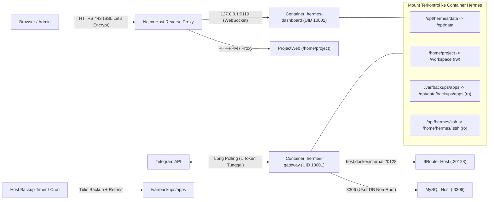

# AI-V1 — Standar & Blueprint Setup Server VPS (Hermes · 9Router · ProjectWeb · Telegram)

Dokumen ini adalah panduan standar arsitektur, keamanan, dan operasional (*runbook*) untuk mengelola VPS produksi yang menjalankan **Hermes Agent**, **9Router AI Gateway**, **ProjectWeb (aplikasi web tim developer AI)**, dan **Bot Telegram** secara aman, terisolasi, dan konsisten.

> **Prinsip Utama AI-V1:**
> * **Aman secara default:** Layanan AI berjalan sebagai user **non-root** di dalam **Docker Compose**, terisolasi dari sistem inti OS (`/etc/ssh`, `/etc/nginx`, `/etc/systemd`).
> * **Produktif untuk tim agent:** Folder proyek web (`/home/project`) dan akses database proyek tetap dibuka secara **terkontrol**, sementara **backup tetap dilindungi di luar izin tulis agen (`:ro`)**.
> * **Bebas konflik & stabil:** Satu token bot Telegram hanya untuk satu gateway, semua secret pakai `.env` (tidak pernah di-commit ke Git), dan setiap subdomain wajib memiliki virtual host Nginx + sertifikat SSL sendiri.

---

## 1. Arsitektur Sistem (AI-V1)



---

## 2. Peta Direktori, Port, & Service Standar

### A. Direktori di VPS
| Path di Host | Pemilik (`UID:GID`) | Fungsi | Akses Container Hermes |
| :--- | :--- | :--- | :--- |
| `/opt/hermes/docker-compose.yml` | `root:root` (`644`) | Definisi stack Docker Hermes | Tidak di-mount |
| `/opt/hermes/data` | `10001:10001` (`hermes`) | Data runtime Hermes (`config.yaml`, `.env`, `profiles/`, `desktop-plugins/`, `cron/`, `skills/`, `state.db`, `scripts/`) | `/opt/data` (`rw`) |
| `/opt/hermes/ssh` | `10001:10001` (`700`/`600`) | SSH key khusus monitoring server eksternal | `/home/hermes/.ssh` (`ro`) |
| `/home/project` | `www-data` / `dev` / grup bersama | Source code aplikasi web buatan tim agent | `/workspace` (`rw`) |
| `/var/backups/apps` | `root:root` | Dump SQL harian & arsip mingguan aplikasi | `/opt/data/backups/apps` (`ro`) |
| `/etc/nginx`, `/etc/systemd`, `/etc/ssh` | `root:root` | Konfigurasi inti host OS & SSL | **Dilarang di-mount** |

### B. Peta Port Layanan
| Service | Bind Address & Port | Akses Publik | Keterangan |
| :--- | :--- | :--- | :--- |
| **Nginx** | `0.0.0.0:80`, `0.0.0.0:443` | Ya (HTTPS) | Reverse proxy + SSL Let's Encrypt |
| **Hermes Dashboard** | `127.0.0.1:9119` | Via Nginx (`hermes.<DOMAIN>`) | Container wajib listen `0.0.0.0:9119`, dipublish `127.0.0.1:9119:9119` |
| **VPS Monitor Dashboard** | `127.0.0.1:9120` | Via Nginx + `auth_basic` (`monitor.<DOMAIN>`) | Dashboard inventaris & status server read-only ([`vps-dashboard/`](./vps-dashboard/README.md)) |
| **9Router Primary** | `127.0.0.1:20128` (+ bridge GW) | Opsional via Nginx + `auth_basic` | AI Gateway utama untuk Hermes |
| **9Router Secondary** | `127.0.0.1:20129` | Opsional via Nginx + `auth_basic` | Cadangan / instance terpisah |
| **MySQL / MariaDB** | `127.0.0.1:3306` (+ bridge GW) | Tidak | Hanya boleh diakses user DB non-root oleh app/container |

---

## 3. Breakdown Setup Bagian 1 — Hardening VPS Host

> **Penting — Jika VPS Sudah Memiliki Data Existing (Web/DB/Hermes Aktif):**
> **Wajib** lakukan backup penuh dan ikuti aturan penanganan data existing di [`MIGRATION_EXISTING_VPS.md`](./MIGRATION_EXISTING_VPS.md) terlebih dahulu sebelum menjalankan langkah-langkah di bawah ini (jangan langsung `chown -R` pada folder web live atau menyalakan container sebelum service Telegram lama dimatikan).

Lakukan pada VPS baru atau VPS aktif (`Ubuntu 24.04 LTS` disarankan, minimal `2 vCPU / 4 GB RAM / 60 GB SSD`):

1. **Akses SSH Key-Only (Nonaktifkan Login Password)**
   - Pasang public key di `~/.ssh/authorized_keys` user admin (`ubuntu`) dan uji login sebelum menutup password.
   - Edit `/etc/ssh/sshd_config`:
     ```text
     PasswordAuthentication no
     PermitRootLogin prohibit-password
     ```
   - Reload SSH: `sudo systemctl reload ssh`.
2. **Buat User Sistem Non-Root untuk Container Hermes**
   ```bash
   sudo groupadd -g 10001 hermes
   sudo useradd -u 10001 -g 10001 -m -s /usr/sbin/nologin hermes
   sudo mkdir -p /opt/hermes/data /opt/hermes/ssh /var/backups/apps /home/project
   sudo chown -R 10001:10001 /opt/hermes/data /opt/hermes/ssh
   ```
   > **Aturan `/home/project`:** Pastikan permission `/home/project` mengizinkan user `10001` maupun `www-data` membaca/menulis file proyek (misal lewat grup `dev` + `chmod 2775` / ACL `setfacl -R -m u:10001:rwX,d:u:10001:rwX /home/project`).
3. **Instal Docker Engine & Log Rotation**
   - Instal `docker-ce`, `docker-ce-cli`, `containerd.io`, dan `docker-compose-plugin` dari repositori resmi Docker.
   - Wajib batasi log container di `/etc/docker/daemon.json` agar disk tidak penuh:
     ```json
     {
       "log-driver": "json-file",
       "log-opts": {
         "max-size": "10m",
         "max-file": "3"
       }
     }
     ```
4. **Firewall (`ufw`)**
   - Izinkan dari publik hanya `22/tcp` (SSH), `80/tcp` (HTTP), dan `443/tcp` (HTTPS).
   - Dari subnet Docker Hermes (`172.28.10.0/24`), hanya izinkan port yang memang diperlukan (`20128/tcp` untuk 9Router dan `3306/tcp` untuk MySQL).

---

## 4. Breakdown Setup Bagian 2 — Hermes Agent (Docker Non-Root)

Hermes Agent menggunakan image dari `Dockerfile` resminya dengan `s6-overlay` (`/init`) yang otomatis menurunkan privilege ke `HERMES_UID` / `HERMES_GID`.

### Contoh `/opt/hermes/docker-compose.yml`
```yaml
networks:
  hermes-net:
    driver: bridge
    ipam:
      config:
        - subnet: 172.28.10.0/24
          gateway: 172.28.10.1

services:
  hermes-gateway:
    build:
      context: /opt/hermes/hermes-agent-src
    image: hermes-agent:local
    container_name: hermes-gateway
    restart: unless-stopped
    networks:
      - hermes-net
    extra_hosts:
      - "host.docker.internal:host-gateway"
    environment:
      - HERMES_UID=10001
      - HERMES_GID=10001
      - TZ=Asia/Jakarta
    volumes:
      - /opt/hermes/data:/opt/data
      - /home/project:/workspace
      - /var/backups/apps:/opt/data/backups/apps:ro
      - /opt/hermes/ssh:/home/hermes/.ssh:ro
    mem_limit: 1200m
    cpus: "1.2"
    healthcheck:
      test: ["CMD-SHELL", "test -S /opt/data/gateway.sock"]
      interval: 30s
      timeout: 5s
      retries: 3
    command: ["gateway", "run"]

  hermes-dashboard:
    image: hermes-agent:local
    container_name: hermes-dashboard
    restart: unless-stopped
    depends_on:
      hermes-gateway:
        condition: service_healthy
    networks:
      - hermes-net
    extra_hosts:
      - "host.docker.internal:host-gateway"
    ports:
      - "127.0.0.1:9119:9119"
    environment:
      - HERMES_UID=10001
      - HERMES_GID=10001
      - TZ=Asia/Jakarta
    volumes:
      - /opt/hermes/data:/opt/data
      - /home/project:/workspace
    mem_limit: 512m
    cpus: "0.6"
    healthcheck:
      test: ["CMD-SHELL", "python3 -c \"import urllib.request; urllib.request.urlopen('http://127.0.0.1:9119/login', timeout=3)\""]
      interval: 30s
      timeout: 5s
      retries: 3
    command: ["dashboard", "--host", "0.0.0.0", "--no-open"]
```

### Aturan Konfigurasi Internal Hermes (`/opt/hermes/data/config.yaml`)
1. **Path di Skrip & Cron:** Semua path di `/opt/hermes/data/scripts/` dan `/opt/hermes/data/cron/jobs.json` harus memakai `/opt/data/...` dan `/workspace/...` (hindari hardcode `/root/.hermes`).
2. **Keamanan Dashboard:** Karena `dashboard.public_url: https://hermes.<DOMAIN>` disetel untuk akses publik via reverse proxy, **`dashboard.basic_auth` (username & password hash kuat) wajib aktif**. Jangan pernah membuka dashboard tanpa autentikasi.
3. **Log Rotation & Kebersihan Profil:** Pastikan tidak ada definisi plugin auth duplikat di folder `profiles/*/config.yaml` yang bertabrakan dengan launch scope utama.

### Slot Plugin Opsional: Office 3D (`hermes plugins install office-3d`)
Jika ingin menampilkan visualisasi kantor 3D (*real-time* status aktif/idle, penggunaan token, dan inspeksi meja per profil agent `pm-lead`, `ops-*`, `dev-*`) di Hermes Dashboard / Desktop:
1. **Lokasi Slot Plugin:** `/opt/hermes/data/desktop-plugins/office-3d` (di dalam container: `/opt/data/desktop-plugins/office-3d`, kepemilikan `10001:10001`).
2. **Cara Instalasi Aman (Non-Root di Launch Scope Utama):**
   ```bash
   sudo mkdir -p /opt/hermes/data/desktop-plugins
   sudo chown -R 10001:10001 /opt/hermes/data/desktop-plugins
   docker compose -f /opt/hermes/docker-compose.yml exec hermes-dashboard hermes plugins install office-3d
   docker compose -f /opt/hermes/docker-compose.yml restart hermes-dashboard
   ```
3. **Aturan Isolasi:** Instal `office-3d` hanya di *launch scope* utama (`/opt/data/desktop-plugins/`). Jangan menduplikasi blok plugin auth di masing-masing `profiles/*/config.yaml`.

---

## 5. Breakdown Setup Bagian 3 — 9Router AI Gateway

`9Router` berfungsi sebagai gerbang model AI terpusat (`OpenAI-compatible` endpoint) yang melakukan *routing* & *fallback* ke berbagai provider (OpenRouter, Groq, Gemini, Sumopod, dll.).

1. **Konfigurasi Systemd Host (`9router.service`):**
   - Jalankan di port `20128` (dan `20129` untuk instance kedua bila dipakai) dengan batas memori agar tidak memicu OOM di VPS (`MemoryHigh=1300M`, `MemoryMax=1600M`).
   - Jika container Hermes menggunakan bridge `hermes-net` (`172.28.10.0/24`), pastikan 9Router dapat diakses melalui `http://host.docker.internal:20128/v1` (misal listen pada `172.28.10.1` atau proxy loopback lokal, lalu batasi port `20128` via UFW hanya dari `172.28.10.0/24`).
2. **Wajib Pasang `key_env` di `config.yaml` Hermes:**
   ```yaml
   model:
     default: <NAMA_MODEL_COMBO>
     provider: custom-http
     base_url: http://host.docker.internal:20128/v1
     context_length: 128000

   providers:
     custom-http:
       api: http://host.docker.internal:20128/v1
       key_env: NINEROUTER_API_KEY
       models:
         <NAMA_MODEL_COMBO>:
           context_length: 128000
     ninerouter:
       api: http://host.docker.internal:20128/v1
       key_env: NINEROUTER_API_KEY
   ```
   > **Catatan Bug yang Pernah Terjadi:** Mengosongkan `key_env` pada `providers.custom-http` memicu warning `auxiliary_client: named custom provider 'custom-http' has no resolvable api_key` dan berisiko mengembalikan `401` pada endpoint berautentikasi.
3. **Akses Web 9Router:** Jika dashboard web 9Router diekspos ke domain `https://9router.<DOMAIN>`, wajib dipasang di Nginx dengan `auth_basic` (`9router.htpasswd`) dan sertifikat Let's Encrypt tersendiri.

---

## 6. Breakdown Setup Bagian 4 — ProjectWeb, MySQL, & Nginx/SSL

### A. Akses Terkontrol untuk ProjectWeb (`/home/project`)
* Setiap aplikasi web (`sim-pt`, `webkampus`, `e-masjid`, dll.) berada di `/home/project/<nama-app>` dan dikelola menggunakan **Git** (biasakan commit atau gunakan branch kerja sebelum perubahan besar oleh agen).
* Dari dalam container Hermes, proyek terlihat di `/workspace/<nama-app>`.

### B. Akun MySQL Khusus Developer Agent (Jangan Pakai `root` MySQL)
Buat user MySQL terbatas untuk pengembangan/migrasi proyek agar tidak bisa memengaruhi database sistem atau skema lain yang tidak relevan:
```sql
CREATE USER '<DB_AGENT_USER>'@'172.28.10.%' IDENTIFIED BY '<DB_AGENT_PASSWORD>';
CREATE USER '<DB_AGENT_USER>'@'127.0.0.1' IDENTIFIED BY '<DB_AGENT_PASSWORD>';
GRANT ALL PRIVILEGES ON `<NAMA_DB_PROYEK>`.* TO '<DB_AGENT_USER>'@'172.28.10.%';
GRANT ALL PRIVILEGES ON `<NAMA_DB_PROYEK>`.* TO '<DB_AGENT_USER>'@'127.0.0.1';
FLUSH PRIVILEGES;
```
> **Larangan Keras di `AGENTS.md` Proyek:** Agen dilarang menjalankan `migrate:fresh`, `db:wipe`, atau `DROP DATABASE` pada database produksi tanpa konfirmasi eksplisit dan backup terbaru terverifikasi.

### C. Standar Nginx Reverse Proxy + Certbot SSL
Setiap subdomain **wajib** memiliki file sendiri di `/etc/nginx/sites-available/<nama>` dan symlink di `/etc/nginx/sites-enabled/<nama>`, serta sertifikat Let's Encrypt sendiri (`sudo certbot --nginx -d <subdomain> --redirect`).

Contoh template untuk **Hermes Dashboard (`hermes.<DOMAIN>`)**:
```nginx
server {
    listen 80;
    listen [::]:80;
    server_name hermes.<DOMAIN>;

    client_max_body_size 50m;

    location / {
        proxy_pass http://127.0.0.1:9119;
        proxy_http_version 1.1;
        proxy_set_header Upgrade           $http_upgrade;
        proxy_set_header Connection        "upgrade";
        proxy_set_header Host              $host;
        proxy_set_header X-Real-IP         $remote_addr;
        proxy_set_header X-Forwarded-For   $proxy_add_x_forwarded_for;
        proxy_set_header X-Forwarded-Proto $scheme;
        proxy_read_timeout 300s;
        proxy_buffering off;
    }
}
```
> **Pelajaran Kasus `hermes.imam.my.id`:** Jika sebuah subdomain sudah diarahkan DNS-nya ke IP VPS tetapi belum punya blok `server_name` + sertifikat SSL di Nginx, Nginx akan menjatuhkan request ke virtual host lain (misalnya `9router`), menyebabkan error SSL domain mismatch (`SEC_E_WRONG_PRINCIPAL`) dan halaman `401 Unauthorized` milik layanan lain.

---

## 7. Breakdown Setup Bagian 5 — Telegram Bot (Anti-Conflict Rule)

Telegram **Bot API Long Polling (`getUpdates`)** hanya mengizinkan **1 proses aktif per 1 token bot** di seluruh dunia (baik di VPS yang sama, container lain, maupun server lokal).

### Aturan Wajib Setup Telegram
1. **1 Token = 1 Service:** Jangan pernah menjalankan skrip bot standalone (misal skrip Python `getUpdates` terpisah) atau profil Hermes lain dengan `TELEGRAM_BOT_TOKEN` yang sama dengan `hermes-gateway`.
2. **Variabel Lingkungan Minimal (`.env` di `/opt/hermes/data/.env`):**
   ```env
   TELEGRAM_BOT_TOKEN=<TELEGRAM_BOT_TOKEN>
   TELEGRAM_ALLOWED_USERS=<USER_ID_ADMIN_TELEGRAM>
   TELEGRAM_HOME_CHANNEL=<CHAT_ID_UTAMA>
   NINEROUTER_API_KEY=<NINEROUTER_API_KEY>
   ```
3. **Konfigurasi `config.yaml`:**
   ```yaml
   platforms:
     telegram:
       enabled: true
   gateway:
     multiplex_profiles: true
   ```
   *(Profil tambahan yang tidak memiliki token bot terpisah biarkan tanpa `TELEGRAM_BOT_TOKEN` atau set `platforms.telegram.enabled: false` agar tidak menimpa/bentrok dengan gateway utama.)*
4. **Prosedur Cutover Nol Konflik:**
   - Sebelum menyalakan container baru atau pindah host, **hentikan dulu service lama** (`systemctl --user stop hermes-gateway` / matikan skrip duplikat) dan pastikan `pgrep -af hermes` kosong.
   - Baru jalankan `docker compose up -d`.

---

## 8. Strategi Backup, Retensi Disk, & Rollback

### A. Backup Independen oleh Host (Read-Only bagi Agent)
* Backup database & file aplikasi dijalankan oleh **systemd timer / cron milik `root` di host**, menulis ke `/var/backups/apps`.
* Container Hermes me-mount `/var/backups/apps` dengan mode **`:ro` (read-only)** sehingga agen masih bisa membuat laporan kesehatan backup (`daily_uptime_report.sh`), tetapi **tidak bisa menghapus atau merusak file backup**.
* **Wajib Atur Retensi:** Jangan menumpuk arsip `.tar.gz` mingguan tanpa batas di VPS berkapasitas 59 GB (sebelumnya memakan `14 GB`). Terapkan rotasi otomatis:
  - Dump SQL harian: simpan **5–7 file terbaru** per database.
  - Arsip file mingguan `.tar.gz`: simpan maksimal **2 arsip terbaru** di VPS, dan sinkronkan arsip lama ke penyimpanan off-site (Google Drive / S3 / `rclone`).

### B. Checklist Verifikasi Setelah Setup / Migrasi
- [ ] `docker compose ps` menunjukkan `hermes-gateway` dan `hermes-dashboard` berstatus `Up (healthy)`.
- [ ] Log `hermes-gateway` bersih dari warning `Running as ROOT` dan `Conflict: terminated by other getUpdates request`.
- [ ] `curl -I https://hermes.<DOMAIN>/` merespons `302 -> /login?next=%2F` dengan sertifikat SSL cocok untuk `hermes.<DOMAIN>`.
- [ ] Chat di Telegram merespons normal dan panggilan AI gateway ke `9Router` mengembalikan `HTTP 200`.
- [ ] Agen di container dapat membaca/menulis `/workspace/<project>`, melakukan query ke DB proyek non-root, tetapi gagal menulis ke `/opt/data/backups/apps` (`Read-only file system`).
- [ ] Penggunaan RAM total (`free -h`) dan ruang kosong disk (`df -h`) berada di batas aman (`disk usage < 70%`).

---

## 9. Panduan Troubleshooting Cepat

| Gejala Error | Penyebab Paling Umum | Cara Mengatasi |
| :--- | :--- | :--- |
| **`SEC_E_WRONG_PRINCIPAL` + `401 9Router`** saat buka `https://hermes.<DOMAIN>` | Virtual host Nginx / sertifikat Certbot subdomain Hermes belum dibuat | Buat `/etc/nginx/sites-available/hermes`, `ln -s` ke `sites-enabled`, jalankan `certbot --nginx -d hermes.<DOMAIN>`, lalu `nginx -t && systemctl reload nginx`. |
| **Telegram error `Conflict: terminated by other getUpdates request`** | Ada proses/skrip/VPS lain yang melakukan polling `getUpdates` dengan token bot yang sama | Cek proses di VPS (`ps aux \| grep -E 'python\|hermes\|bot'`), matikan service duplikat, lalu restart `hermes-gateway`. |
| **`502 Bad Gateway`** setelah Dockerisasi Dashboard | Container dashboard bind ke `127.0.0.1` di dalam network bridge | Ubah command container menjadi `--host 0.0.0.0 --no-open`, dan kunci port mapping host ke `"127.0.0.1:9119:9119"`. |
| **Warning `custom-http has no resolvable api_key`** | Blok `providers.custom-http` di `config.yaml` tidak memiliki `key_env` | Tambahkan `key_env: NINEROUTER_API_KEY` (dan isi nilainya di `.env`), lalu restart gateway. |
| **Disk VPS cepat penuh (>85%)** | Arsip `tar.gz` di `/var/backups/apps` menumpuk atau log Docker tidak dibatasi | Aktifkan rotasi retensi skrip backup + `max-size: 10m` di `/etc/docker/daemon.json` + `docker system prune`. |

---

## 10. Organisasi Tim Agent Otonom (PM · Operasional · Development)

Blueprint lengkap profil agent (`SOUL.md`, `AGENTS.md`, `TOOLS.md`, `USER.md`, `MEMORY.md`, `TASKS.md`, `config.yaml`), kebijakan pemegang kredensial, serta daftar tugas otonom tersedia di folder [`agents/`](./agents/README.md):

* **Pemegang Utama Kredensial & Orkestrator (`pm-lead`):** [`agents/00-pm-coordinator/`](./agents/00-pm-coordinator/) — Satu-satunya pintu gateway Telegram & pemegang master kredensial ([Kebijakan Kredensial](./agents/CREDENTIALS_POLICY.md)).
* **Tim Operasional:**
  * [`agents/ops-sysadmin/`](./agents/ops-sysadmin/) — Monitoring VPS, Docker, `9Router`, dan SSL/Nginx.
  * [`agents/ops-backup-dba/`](./agents/ops-backup-dba/) — Audit backup (`:ro`) & kesehatan MySQL non-root.
  * [`agents/ops-secops/`](./agents/ops-secops/) — Audit keamanan, secret scanning, dan kepatuhan AI-V1.
* **Tim Development:**
  * [`agents/dev-architect/`](./agents/dev-architect/) — Desain arsitektur, pemecahan task teknis, dan code review.
  * [`agents/dev-fullstack/`](./agents/dev-fullstack/) — Implementasi fitur ProjectWeb di `/workspace` & migrasi DB aman.
  * [`agents/dev-qa/`](./agents/dev-qa/) — Automated test, smoke test, dan verifikasi *Release Gate*.
* **Catatan Tugas Lintas Tim:** [`agents/TASKS.md`](./agents/TASKS.md).

---

## 11. VPS Control & Inventory Dashboard (`vps-dashboard/`)

Untuk memantau secara visual apa saja yang sudah terinstall dan berjalan di VPS (resource CPU/RAM/Disk, layanan `systemd`, container Docker, profil agent & slot `office-3d`, masa berlaku SSL, ProjectWeb, serta status backup), gunakan paket dashboard ringan tanpa dependensi eksternal di [`vps-dashboard/`](./vps-dashboard/README.md).


