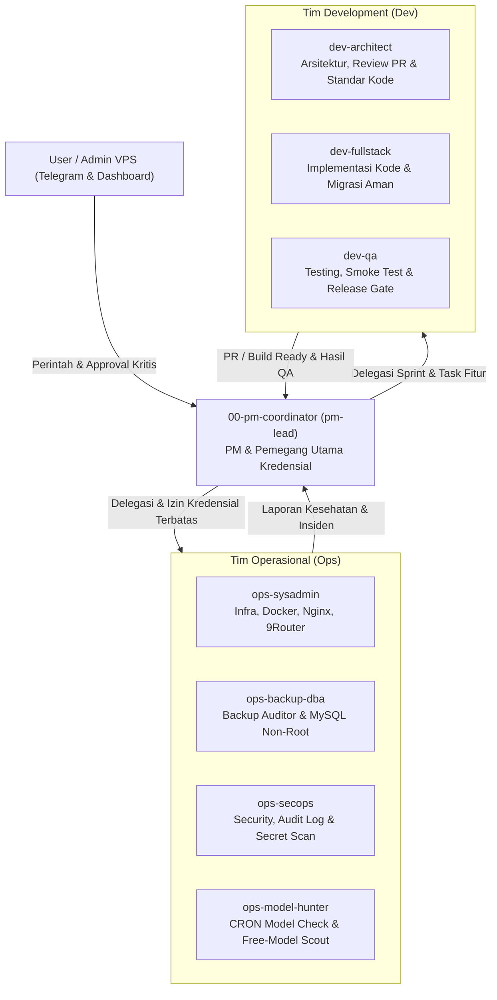

# Organisasi Agent Otonom AI-V1 (PM · Tim Operasional · Tim Development)

Direktori ini berisi definisi lengkap profil, aturan main (*guardrails*), daftar alat (`TOOLS.md`), kepribadian/otoritas (`SOUL.md`), SOP (`AGENTS.md`), memori awal (`MEMORY.md`), konfigurasi Hermes (`config.yaml`), dan daftar tugas (`TASKS.md`) untuk seluruh tim agent AI-V1 agar dapat bekerja **secara otonom, aman, dan terstruktur**.

---

## 1. Struktur Tim & Rantai Komando



### Daftar Lengkap Agent
| Folder | Profile ID Hermes | Tim | Peran Utama | Status Telegram Gateway |
| :--- | :--- | :--- | :--- | :--- |
| [00-pm-coordinator](./00-pm-coordinator/) | `pm-lead` | Manajemen | **Project Manager & Pemegang Utama Kredensial** | `enabled: true` (Satu-satunya Gateway) |
| [ops-sysadmin](./ops-sysadmin/) | `ops-sysadmin` | Operasional | Monitoring VPS, Docker, 9Router, SSL/Nginx | `enabled: false` (Dipanggil via PM/Cron) |
| [ops-backup-dba](./ops-backup-dba/) | `ops-backup-dba` | Operasional | Verifikasi Backup (`:ro`) & Kesehatan MySQL Non-Root | `enabled: false` |
| [ops-secops](./ops-secops/) | `ops-secops` | Operasional | Audit Keamanan, Secret Scan & Kepatuhan AI-V1 | `enabled: false` |
| [ops-model-hunter](./ops-model-hunter/) | `ops-model-hunter` | Operasional | CRON Cek Kuota Model, Auto-Failover & Pencari Model Gratis | `enabled: false` |
| [dev-architect](./dev-architect/) | `dev-architect` | Development | Desain Teknis, Pembagian Task & Code Review | `enabled: false` |
| [dev-fullstack](./dev-fullstack/) | `dev-fullstack` | Development | Coding ProjectWeb (`/workspace/<app>`) & Migrasi Aman | `enabled: false` |
| [dev-qa](./dev-qa/) | `dev-qa` | Development | Automated Test, Smoke Test & Verifikasi Rilis | `enabled: false` |

> **Kepatuhan Anti-Conflict Rule (Telegram):** Sesuai [AI-V1/README.md](../README.md#7-breakdown-setup-bagian-5--telegram-bot-anti-conflict-rule), hanya **satu** profil/gateway (`pm-lead` pada `hermes-gateway`) yang boleh mengaktifkan `platforms.telegram.enabled: true`. Semua agent Ops & Dev **wajib** `enabled: false` agar tidak terjadi error `Conflict: terminated by other getUpdates request`.

---

## 2. Prinsip Pemegang Utama Kredensial (`pm-lead`)

1. **Satu Pintu Kredensial:** Hanya `00-pm-coordinator` (`pm-lead`) yang memegang master kredensial dan inventaris secret (mengacu pada [CREDENTIALS_POLICY.md](./CREDENTIALS_POLICY.md)).
2. **Prinsip *Least Privilege*:** Agent Ops dan Dev tidak menyimpan token/password produksi di file `SOUL.md`, `TOOLS.md`, `MEMORY.md`, atau repositori Git. Jika sebuah agent butuh akses sementara (misal user DB khusus satu project atau token API staging), agent mengajukan permintaan ke `pm-lead`.
3. **Host Boundary Tetap Terjaga:** Seluruh agent berjalan di dalam container non-root `UID 10001` (`hermes`). Direktori host sensitif (`/etc/nginx`, `/etc/systemd`, `/etc/ssh`) **tidak pernah** di-mount ke container. Untuk perubahan level host, `ops-sysadmin` menyiapkan skrip/rencana perubahan yang diverifikasi `ops-secops` lalu dieskalasikan `pm-lead` ke Admin VPS.

---

## 3. Cara Setup di VPS dari GitHub (Langkah demi Langkah)

Setelah setup infrastruktur dasar VPS & container Hermes mengikuti [AI-V1/README.md](../README.md), lakukan langkah berikut untuk mengaktifkan seluruh tim agent:

### Langkah 1 — Salin Profil Agent ke `/opt/hermes/data/profiles/`
```bash
# Jalankan sebagai admin VPS, lalu pastikan kepemilikan tetap 10001:10001
for agent_dir in 00-pm-coordinator ops-sysadmin ops-backup-dba ops-secops ops-model-hunter dev-architect dev-fullstack dev-qa; do
  case "$agent_dir" in
    00-pm-coordinator) profile_name="pm-lead" ;;
    *) profile_name="$agent_dir" ;;
  esac
  sudo mkdir -p "/opt/hermes/data/profiles/${profile_name}"
  sudo cp -r "AI-V1/agents/${agent_dir}/." "/opt/hermes/data/profiles/${profile_name}/"
done

sudo chown -R 10001:10001 /opt/hermes/data/profiles
```

### Langkah 2 — Siapkan Kredensial Utama di `/opt/hermes/data/.env` (Khusus PM / Gateway)
```bash
sudo cp AI-V1/agents/00-pm-coordinator/.env.example /opt/hermes/data/.env
sudo chmod 600 /opt/hermes/data/.env
sudo chown 10001:10001 /opt/hermes/data/.env
# Edit /opt/hermes/data/.env dan isi seluruh token/password asli
```

### Langkah 3 — Siapkan Direktori Kerja, Task Board, & Slot Plugin `office-3d`
```bash
sudo mkdir -p /opt/hermes/data/shared/tasks /opt/hermes/data/shared/reports /opt/hermes/data/credentials /opt/hermes/data/desktop-plugins /opt/hermes/data/scripts /opt/hermes/data/cron
sudo cp AI-V1/agents/TASKS.md /opt/hermes/data/shared/tasks/TASKS.md
sudo cp AI-V1/agents/worklog.example.json /opt/hermes/data/shared/tasks/worklog.json
sudo cp AI-V1/scripts/check_models.py /opt/hermes/data/scripts/check_models.py
sudo cp AI-V1/agents/cron.jobs.example.json /opt/hermes/data/cron/jobs.json
sudo cp AI-V1/agents/worklog.example.json /opt/hermes/data/shared/tasks/worklog.json
sudo cp AI-V1/scripts/check_models.py /opt/hermes/data/scripts/check_models.py
sudo cp AI-V1/agents/cron.jobs.example.json /opt/hermes/data/cron/jobs.json
sudo cp AI-V1/agents/CREDENTIALS_POLICY.md /opt/hermes/data/credentials/CREDENTIALS_POLICY.md
sudo chown -R 10001:10001 /opt/hermes/data/shared /opt/hermes/data/credentials /opt/hermes/data/desktop-plugins /opt/hermes/data/scripts /opt/hermes/data/cron
sudo chmod 700 /opt/hermes/data/credentials
```

### Langkah 4 — Instal Plugin `office-3d` (Slot Virtual Office Tim Agent)
Plugin `office-3d` menampilkan kantor virtual 3D secara *real-time* di Hermes Dashboard/Desktop, di mana setiap profil agent (`pm-lead`, `ops-*`, `dev-*`) otomatis muncul sebagai meja kerja (*desk*) untuk memantau status aktif/idle, token, dan output terbaru.

```bash
# Jalankan di container hermes-dashboard (non-root UID 10001, launch scope utama)
docker compose -f /opt/hermes/docker-compose.yml exec hermes-dashboard hermes plugins install office-3d
docker compose -f /opt/hermes/docker-compose.yml restart hermes-dashboard
```

> **Aturan Slot `office-3d`:**
> - Lokasi instalasi resmi: `/opt/hermes/data/desktop-plugins/office-3d` (container: `/opt/data/desktop-plugins/office-3d`).
> - Instal hanya di *launch scope* utama — **jangan** menambahkan definisi plugin auth duplikat di `profiles/*/config.yaml`.

### Langkah 5 — Verifikasi Gateway & Mulai Operasi Otonom
1. Pastikan `docker compose -f /opt/hermes/docker-compose.yml up -d` berjalan sehat (`hermes-gateway` & `hermes-dashboard` berstatus `Up (healthy)`).
2. Pastikan hanya `pm-lead` / gateway utama yang membaca `TELEGRAM_BOT_TOKEN`.
3. Kirim perintah awal ke bot Telegram (yang ditangani `pm-lead`):
   > *"Lakukan bootstrap check tim Ops & Dev sesuai `/opt/data/shared/tasks/TASKS.md` dan laporkan status kesiapan masing-masing agent."*

---

## 4. Aturan Wajib Pelaporan Terbuka ke VPS Monitor Dashboard

Agar Admin VPS dapat langsung melihat **pekerjaan yang sedang dikerjakan**, **pekerjaan yang sudah selesai**, dan **status setiap project** melalui VPS Monitor Dashboard (`monitor.<DOMAIN>`) tanpa harus bertanya ke agent:
1. Setiap agent **wajib** memperbarui `/opt/data/shared/tasks/worklog.json` (berdasarkan template [`worklog.example.json`](./worklog.example.json)):
   - Saat **mulai** mengerjakan tugas: tambahkan entri ke `active_work` dan perbarui `project_statuses`.
   - Saat **selesai**: pindahkan entri dari `active_work` ke `completed_work` (sertakan `completed_at` & hash commit / path laporan) dan centang `[x]` pada `/opt/data/shared/tasks/TASKS.md`.
2. `pm-lead` bertugas memastikan `worklog.json` selalu valid JSON dan mencerminkan kondisi terkini seluruh tim.

---

## 4. Struktur File Standar di Setiap Folder Agent

Setiap folder agent memiliki kelengkapan dokumen yang sama agar konsisten dan mudah diaudit:
- `SOUL.md` — Identitas, misi, nilai, batas otonomi, dan larangan keras agent.
- `AGENTS.md` — SOP kolaborasi antar-agent, format handoff tugas, dan aturan workspace/Git.
- `TOOLS.md` — Daftar tool, path container, endpoint internal (`9Router`, `MySQL`), serta batasan akses.
- `USER.md` — Profil Admin/Owner sistem, preferensi bahasa, format pelaporan, dan jam kerja/eskalasi.
- `MEMORY.md` — Memori awal berbasis fakta infrastruktur AI-V1 dan ruang catatan jangka panjang.
- `TASKS.md` — Daftar tugas rutin (cron/periodik) dan tugas operasional/proyek spesifik agent.
- `config.yaml` — Konfigurasi profil Hermes (`custom-http` ke `9Router` dengan `key_env: NINEROUTER_API_KEY`, aturan Telegram non-konflik, dan path `/opt/data`).

